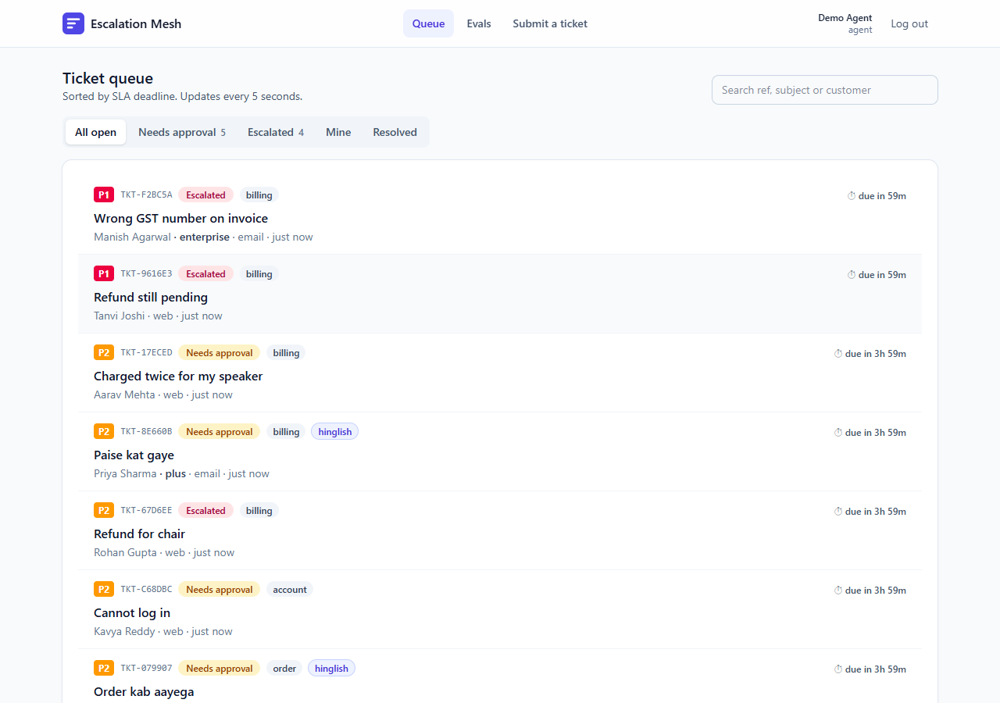
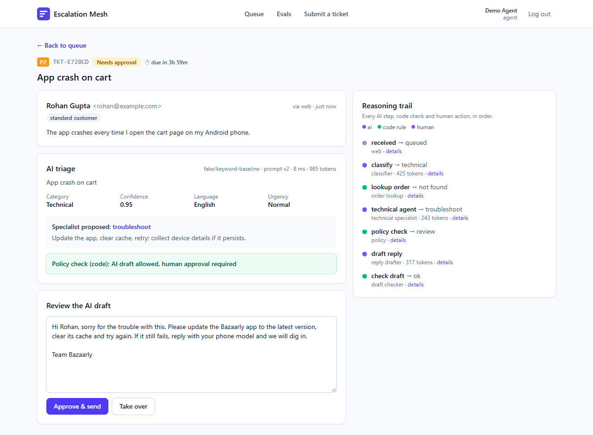
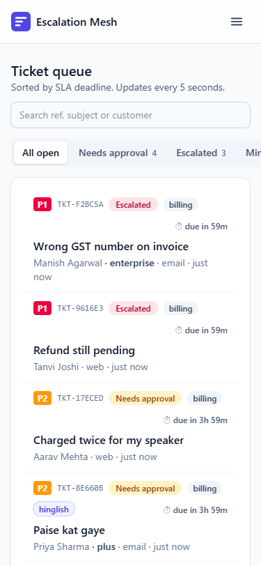
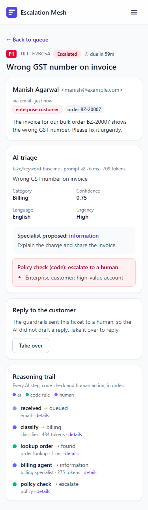
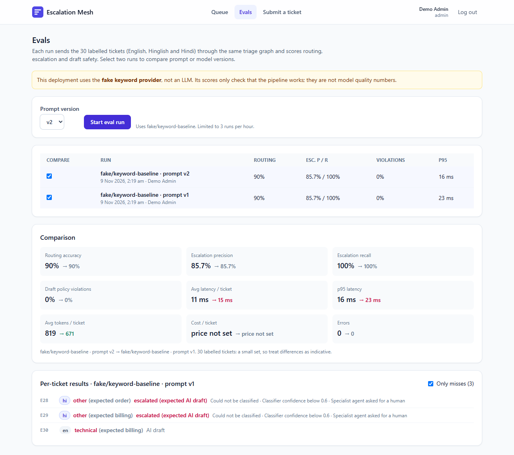
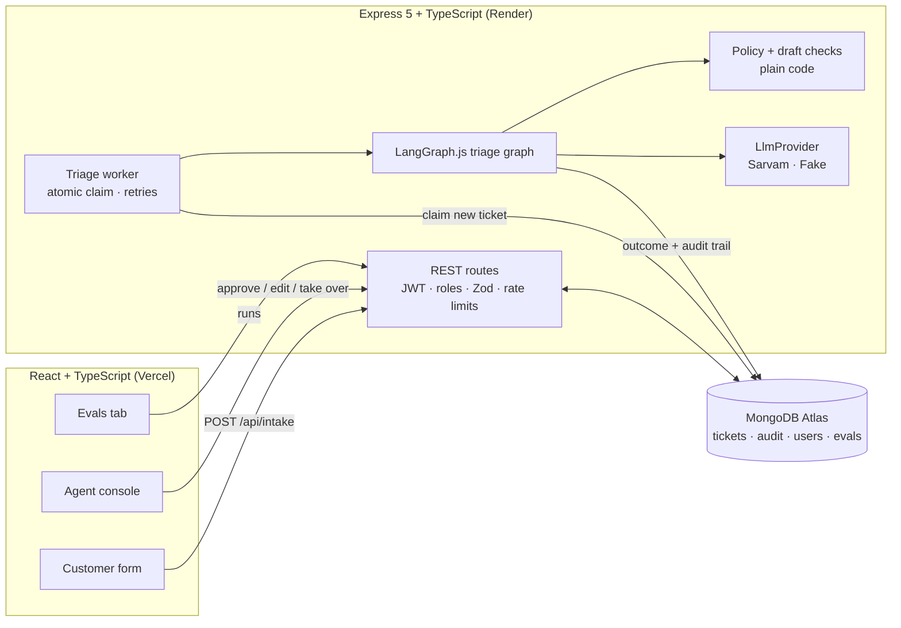
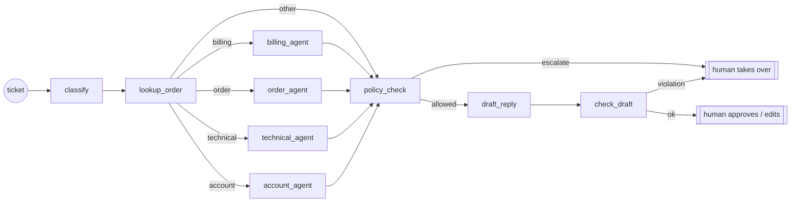

# Support Escalation Mesh

[](https://github.com/Navneet-Rishav/support-escalation-mesh/actions/workflows/ci.yml)

**A MERN + TypeScript support desk.** Customers submit tickets; an Express REST API queues them; AI agents triage each one and draft a reply; **code-level guardrails** decide what the AI may do; and a human agent approves, edits or takes over every ticket in a React console.

> **Live demo:** https://support-escalation-mesh.vercel.app · click **"Try demo as Agent"** (or **Admin**) on the login page; no sign-up needed.
> **API:** https://support-escalation-mesh-api.onrender.com/healthz (Render free tier: the first request after 15 idle minutes can take up to a minute).
> Run it locally in 3 commands: see [Local setup](#local-setup).

| Agent queue | Ticket review (AI draft + reasoning trail) |
|---|---|
|  |  |

| Phone (375px) | | Evals |
|---|---|---|
|  |  |  |

## What it does

"Bazaarly" is a fictional Indian marketplace. Its support desk gets tickets in English, Hindi and Hinglish ("mera order abhi tak nahi aaya").

1. **Intake**: a public web form, or email-style JSON (`{ from, subject, text }`) as an inbound-email webhook would send.
2. **Queue**: tickets are stored in MongoDB with status `new`. A background worker claims them atomically.
3. **Triage graph** (LangGraph.js): classifier → order lookup → specialist agent (billing / order / technical / account) → **policy check (code)** → reply drafter → **draft check (code)**.
4. **Human in the loop**: agents see the queue sorted by SLA deadline, read the AI's reasoning trail, and **approve**, **edit** or **take over**. Escalated tickets get no AI draft at all.
5. **Evals**: a labelled set of 30 tickets measures routing accuracy, escalation precision/recall, draft policy violations, latency and tokens. Two runs (e.g. prompt v1 vs v2) can be compared side by side.

## Engineering highlights

**Backend: Node.js, Express 5, TypeScript, MongoDB/Mongoose**
- REST API with **JWT auth** (bcrypt-hashed passwords) and **role-based access**: `agent` works tickets; `admin` can also re-run triage and start eval runs.
- **Zod validation** on every body, query and env var; one consistent error shape: `{ error: { code, message, details?, requestId } }`.
- **Request-ID logging** (pino), `/healthz`, Helmet, CORS limited to the frontend origin, 100 KB body limit.
- **Rate limits**: per IP on login and public intake, **per user** on the LLM-heavy eval endpoint.
- **MongoDB-backed job queue**: `findOneAndUpdate` claims a ticket atomically, so two workers never take the same one. Failed triage retries up to 3 times, and tickets stuck mid-triage are re-queued after a restart (Render free tier sleeps).
- **Audit trail**: every AI step, code check and human action is stored with input, output, decision, latency and tokens.
- **Graceful degradation**: if the AI provider is unavailable (out of credits, timeout, 5xx after retries), the ticket is triaged by the keyword rules instead, shown as **"Rule-based triage (AI unavailable)"** in the queue, ticket page and reasoning trail, with the same code guardrails. Bad requests and config errors are *not* hidden this way ([DECISIONS §16](docs/DECISIONS.md)).

**Guardrails: the LLM proposes, code decides** ([`policy.ts`](backend/src/domain/policy.ts))
- Refunds above ₹2,000 (configurable) → human. Refunds are capped at the order amount and need a verified order the customer named.
- Mandatory escalation: legal threats, abusive language, enterprise customers, orders ≥ ₹25,000, low classifier confidence, breached SLA.
- Legal/abuse detection runs **in code** and is OR-ed with the model's flags, so a model that misses a threat cannot skip escalation.
- After drafting, a code check blocks replies that promise more money than approved or promise a refund that was not approved.
- **SLA timers**: priority (P1/P2/P3) comes from customer tier and urgency; due times are 1h / 4h / 24h.

**Frontend: React 19, TypeScript, Vite, Tailwind, TanStack Query**
- Live queue (polling) with status tabs, search and SLA countdowns; ticket page with an editable AI draft and a collapsible reasoning trail.
- Loading, empty and error states everywhere; friendly message when the free-tier API is waking up.
- Accessible labels, keyboard focus styles, responsive from 375px (checked at 375 / 768 / 1280).
- One-click **demo login** (agent or admin). The demo queue refills itself when visitors have resolved most tickets.

**AI as a feature, behind an interface**
- `LlmProvider` interface with a **Sarvam AI** client (`sarvam-105b`, timeouts, retries with backoff on 429/5xx) and a **deterministic fake provider** used in tests and CI. Swapping providers touches one file.
- Every model output is validated with Zod; invalid JSON gets one retry with the error message, then fails safely (the ticket goes to a human).

**Testing and CI**
- **74 backend tests** (Vitest + Supertest) against a real in-memory MongoDB: auth, roles, validation, intake, the worker (atomic claim, retries, stale recovery, rule-based fallback on 402/timeout/5xx with guardrails still applied), the graph, guardrails, the Sarvam client (mocked HTTP), and eval metrics.
- **12 frontend tests** (Vitest + Testing Library) plus typecheck, lint and build.
- GitHub Actions runs everything on each push, plus a Docker image build. CI never calls a paid API.

## Architecture





## API overview

| Method | Path | Auth | Purpose |
|---|---|---|---|
| POST | `/api/auth/register` · `/login` · `/demo` | public | Get a JWT (`demo` takes `{ role }`) |
| GET | `/api/auth/me` | any | Current user |
| POST | `/api/intake/web` · `/api/intake/email` | public, rate-limited | Submit a ticket |
| GET | `/api/tickets?view=open\|mine\|all&status=&category=&q=` | agent | Queue, sorted by SLA, with status counts |
| GET | `/api/tickets/:id` | agent | Ticket + audit trail |
| POST | `/api/tickets/:id/approve` | agent | Send the AI draft, or `{ reply }` to send an edited one |
| POST | `/api/tickets/:id/take-over` | agent | Take ownership (required for escalated tickets) |
| POST | `/api/tickets/:id/retriage` | **admin** | Put back in the AI queue |
| GET | `/api/evals/dataset` · `/runs` · `/runs/:id` | agent | Labelled set and run results |
| POST | `/api/evals/runs` | **admin**, 3/hour | Start an eval run `{ promptVersion }` |
| GET | `/healthz` | public | Liveness + DB status |

## Eval results

The eval set is 30 hand-labelled tickets ([`dataset.ts`](backend/src/evals/dataset.ts)): 20 English, 8 Hinglish, 2 Hindi (Devanagari), including legal threats, abuse, high-value orders and ambiguous cases. 12 should escalate.

| Provider | Prompt | Routing acc. | Escalation P / R | Draft violations | p95 latency |
|---|---|---|---|---|---|
| Fake keyword baseline | v2 | 90% | 85.7% / 100% | 0% | under 30 ms |
| Sarvam `sarvam-105b` | v1 | **100%** (30/30) | **92.3% / 100%** | 0% | 99.6 s (avg 25.9 s) |
| Sarvam `sarvam-105b` · `reasoning_effort=low` · classifier on `sarvam-105b-conversations` | v1 | 86.7% | 92.3% / 100% | 0% | 65.0 s (avg 19.2 s) |
| Sarvam `sarvam-105b` | v2 | _not measured yet: the API account ran out of credits after 8 of 30 cases_ | | | |

**Read the fake row carefully:** it is a keyword matcher written alongside this dataset, so its score only shows the pipeline works end to end. It is not a model-quality number. Its misses are the two Devanagari tickets (no Hindi keywords) and one ticket that mentions both a payment error and a failed order.

**Sarvam v1** (measured 10 Nov 2026, run stored in the live Evals tab): every ticket was routed correctly, including the Hinglish and Devanagari ones. All 12 tickets that should escalate did. One extra ticket (E16, an account case) was escalated when it didn't need to be. That is the safe direction to be wrong, because a human sees it. No AI draft broke a policy rule. Average 3,137 tokens per ticket. Latency is the weak spot: `sarvam-105b` reasons before answering, so triage averages ~26 s and p95 is ~100 s. That is fine for an async queue with a human reviewer but would not suit a live chat. 30 tickets is a small set, so treat any number as indicative.

**Latency experiment** (10 Nov 2026, same v1 prompt, one run of 30): lower reasoning effort plus a non-reasoning classifier cut average latency by ~26% (25.9 → 19.2 s) and p95 by ~35% (99.6 → 65.0 s), and used ~17% fewer tokens. But routing fell from 100% to 86.7%: three billing tickets about failed payments for orders were routed to `order`. All three were still escalated, so no unsafe outcome. One case returned an empty message. **Not adopted**: 19 s is still slow, and the routing loss is real. Next to try: `reasoning_effort=low` alone (keeping the main model as the classifier), to see which change caused the routing drop. Single runs on 30 tickets; latency also varies with API load.

Run it yourself: `npm --prefix backend run eval -- v2` (uses `LLM_PROVIDER` from `backend/.env`).

## Local setup

Requires Node.js 20+. No Docker or database needed: by default the API starts an in-memory MongoDB and seeds demo data.

```bash
git clone https://github.com/Navneet-Rishav/support-escalation-mesh.git && cd support-escalation-mesh
npm run setup      # installs backend + frontend and creates backend/.env from .env.example
npm run dev        # API on http://localhost:4000, console on http://localhost:5173
```

Open http://localhost:5173 and click **Try demo as Agent**. Tests: `npm test`.

To use a real database instead, set `MONGODB_URI` in `backend/.env` (e.g. `docker compose up mongo` → `mongodb://localhost:27017/mesh`, or an Atlas URI), then `npm run seed`. To use Sarvam, set `LLM_PROVIDER=sarvam` and `SARVAM_API_KEY`.

## Project structure

```
backend/
  src/
    routes/        auth, intake, tickets, evals (Express routers)
    middleware/    JWT + roles, Zod parsing, errors, rate limits
    models/        Mongoose: User, Customer, Order, Ticket, AuditEvent, EvalRun
    domain/        policy (guardrails), SLA, text detectors: pure functions, unit-tested
    agents/        LangGraph graph, versioned prompts, output schemas
    llm/           LlmProvider interface, Sarvam client, fake provider, JSON validation
    services/      triage worker + queue, human actions, demo data
    evals/         labelled dataset, runner, metrics
  tests/           Vitest + Supertest + mongodb-memory-server
frontend/src/
  pages/           Login, Queue, Ticket, Evals, Submit
  lib/             API client, auth context, formatting
docs/DECISIONS.md  why each major choice was made
```

## Design decisions and known limitations

Full reasoning, with alternatives considered, is in [docs/DECISIONS.md](docs/DECISIONS.md). In short:

- **Every reply needs human approval.** No auto-send, even for "safe" categories. This makes the product slower but keeps risk low, and it is the point of the project.
- **The worker runs inside the API process.** It is simple and fits the free tier, but does not scale horizontally beyond the atomic claim. A real deployment would use a separate worker or a managed queue.
- **The keyword detectors are small lists.** They will miss creative phrasing; the LLM's flags are the second line of defence.
- **Render free tier sleeps after 15 minutes idle.** The first request can take up to a minute; the UI says so.
- **Triage is slow with a reasoning model** (~26 s average per ticket with `sarvam-105b` at default reasoning). The UI shows "AI is triaging…" with elapsed time. `SARVAM_REASONING_EFFORT` and `SARVAM_CLASSIFY_MODEL` (a non-reasoning model for the classifier) exist to cut this; their effect has **not been measured yet** ([DECISIONS §17](docs/DECISIONS.md)).
- **If the LLM API is unavailable**, tickets get rule-based triage (see above), which is less accurate than the model (e.g. it misses Devanagari tickets). Agents see the label and review as usual. Nothing is auto-sent.
- **Bearer tokens in localStorage**, because the API and UI are on different domains. This is vulnerable to XSS (mitigated by React escaping and no `dangerouslySetInnerHTML`). httpOnly cookies would be the next step.
- **Not built:** outbound email sending (replies are recorded, not emailed), multi-tenant support, attachments.

## License

MIT. Bazaarly, its customers and orders are fictional.
